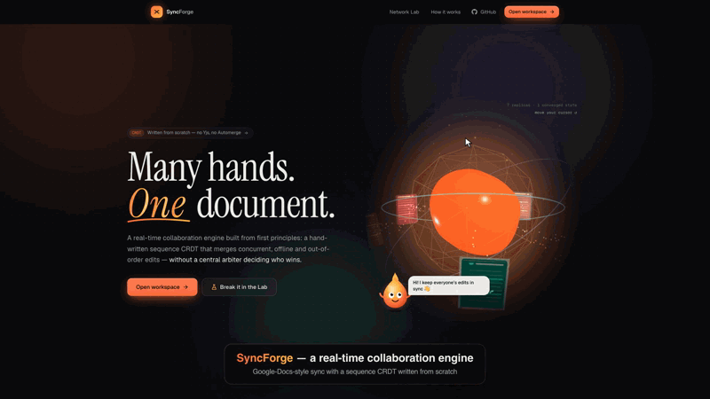
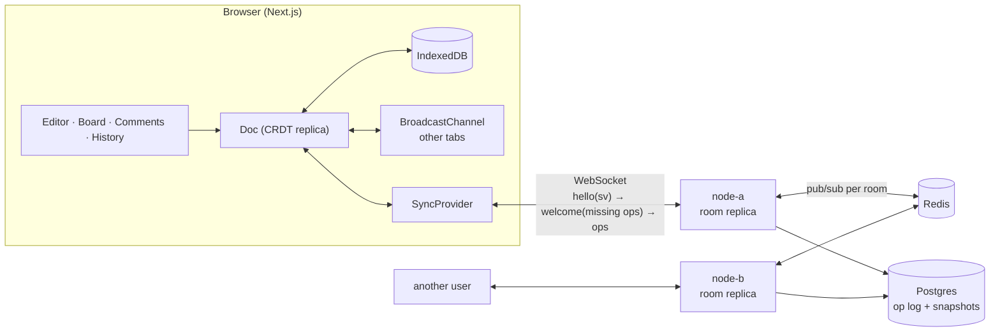

<div align="center">

# SyncForge

**Many hands. One document.**

A real-time collaboration engine (shared documents, comments, version history and a multiplayer whiteboard) built on a **sequence CRDT written from scratch**. No Yjs, no Automerge.



▶ **[Watch the full 2½-minute demo with captions](docs/media/demo.webm)**: a real screen recording of the running app, with two users on two different server nodes

</div>

---

## Why this project

"Build Google Docs" is really a dozen hard problems hiding behind one textbox. Take five people editing one technical document:

| User | Does | The actual problem |
|---|---|---|
| A | writes a paragraph | concurrent inserts, cursor stability for everyone else |
| B | deletes words **inside A's paragraph** | insert vs delete on overlapping ranges |
| C | is offline for hours | long divergence, then a large merge |
| D | adds comments | anchors that survive the text changing underneath |
| E | restores an old version | going "back in time" without erasing A–D |

The goal is **strong eventual consistency**: any two replicas that have seen the same *set* of operations are identical, whatever the order, delay or duplication. Before writing any code I spent the first part of the project listing everything that can go wrong. That write-up is in **[docs/PROBLEM_ANALYSIS.md](docs/PROBLEM_ANALYSIS.md)**, and every design decision below traces back to it.

## What's inside

- **Hand-written sequence CRDT** (`packages/crdt`): YATA-style integration (left + right origins, client-id tie-break), state vectors, a causal pending buffer, tombstones, LWW maps on Lamport clocks, compaction, time-travel and undo. All of it is covered by randomised convergence tests.
- **Collaborative editor**: live remote cursors and selections, authorship ("blame") colours, per-user undo.
- **Offline-first**: IndexedDB persistence, delta sync on reconnect, tab-to-tab sync over `BroadcastChannel` with no network at all.
- **Comments** anchored to *character ids* rather than indexes, so they follow the text and report when it's gone.
- **Version history**: diff any version against now, and restore as a *forward* edit that keeps everyone's concurrent work.
- **Multiplayer whiteboard**: shapes, sticky notes and freehand drawing, with live pointers and LWW registers.
- **Access control**: owner, editor, commenter and viewer roles, enforced **per operation** on the server. Forged authorship is rejected and signed invite links are supported.
- **Horizontal scaling**: any number of WebSocket nodes share rooms through Redis, with Postgres holding the op log and merge-safe compacted snapshots.
- **Network Lab**: three in-browser replicas over a hostile simulated network with latency, loss, duplication and partitions, so you can watch the CRDT converge.

## Architecture



The server is a **replica, not a judge**. It applies ops to its own copy of the document so it can serve diffs and snapshots, persists them and relays them, but it never resolves conflicts, because there are none to resolve. That means no sticky sessions, no leader election and no ordering guarantees needed from Redis.

### The sync handshake

1. Client → `hello { sv }`: "here is what I have" (a state vector `{clientId → next clock}`).
2. Server → `welcome { ops }`: exactly the ops the client is missing, plus the server's vector.
3. Client → `ops`: whatever the server is missing (everything done offline).
4. After that, ops stream in small batches. Acks carry the server's vector, which drives the "N unsynced" counter and re-sends anything that got lost.

## The CRDT, briefly

Every character gets a globally unique id `(clientId, clock)` and remembers the neighbours it was typed between: its **left origin** and **right origin**. Deleted characters stay in the sequence as **tombstones**.

The brief's example, run through the real implementation:

```
base:  H E L L O
A:     appends " WORLD"        → HELLO WORLD
B:     inserts "Y " after "HE" → HEY LLO
merge: both replicas           → HEY LLO WORLD
```

When two inserts land between the same origins, every replica scans the same region and applies the same rule (concurrent siblings are ordered by client id, and each sibling's subtree is skipped as a unit). Because each typed character's left origin is the previous character *of the same run*, two words typed at the same spot **never interleave** (`HELLOWORLD`, never `HWEOLRLLOD`).

| Edge case | How it's handled |
|---|---|
| Out-of-order delivery | ops wait in a pending buffer until their origins / same-client predecessor arrive |
| Duplicates | state vector: an op below the vector is dropped; partially-known runs are trimmed |
| Insert into text someone deleted | the insert's origin is a tombstone, so it lands exactly where intended |
| Two tabs, same client id | impossible: a fresh client id per session (reused ids would silently corrupt state) |
| Emoji / surrogate pairs | the textarea diff never splits a pair |
| Restore an old version | new ops: delete what's new, re-insert what was removed *next to its own tombstones* |
| Comments on restored text | revived inserts record the ids they replace (`rv`), so anchors re-attach on every replica |
| Undo in multiplayer | undoes **your** ops only, as new ops, never a colleague's |
| Whiteboard move vs delete | per-field LWW on **Lamport** clocks (never wall clocks); delete is just another field |
| Overwritten whiteboard updates | compacted to `gc` stubs: 300 drags → 2 ops in a snapshot |
| Forged authorship | server binds each client id to the first user who used it and rejects the rest |
| Two nodes compacting at once | advisory lock + CRDT-merge of stored snapshot, log and new snapshot, so nothing is lost |
| Crash between broadcast and persist | the op still lives on clients; the next handshake re-uploads it |

## Results

All numbers are from this repo on a laptop, not marketing:

| | |
|---|---|
| CRDT unit + property tests | **31 tests**, convergence fuzzed over **3,000 random schedules** (shuffled, duplicated, dropped, partitioned), 0 divergences |
| Server end-to-end tests | **10 tests** over real WebSockets, incl. offline merge, role enforcement, forged ops, 2-node fan-out, real Postgres + Redis |
| Load test | **100 bots on 2 nodes** (Postgres + Redis) editing one doc: all **converged**, edit → peer latency **p50 22 ms · p95 37 ms · p99 48 ms** |
| Typing on a 40k-char document | ~**1 µs** per keystroke (search-marker cache; it was 240 µs before) |
| Rebuild a 40k-char replica from a snapshot | ~**26 ms** |

At 200 bots everything still converges, but latency climbs because the *load generator* (200 full replicas in one Node process) saturates a CPU core while the servers sit under 2%. Splitting the generator across processes is on the list.

## Running it

Requirements: Node 22+.

```bash
npm install
npm run dev            # sync server on :4000 (in-memory) + web on :3000
```

Open http://localhost:3000 and create a document. To be a second person, open **http://127.0.0.1:3000** (separate storage, so it's a different user) and paste the document URL.

**Two nodes, Postgres + Redis** (the real topology):

```bash
docker compose up --build
# Ada:   http://localhost:3000
# Grace: http://127.0.0.1:3000/d/<doc-id>?node=4001   ← talks to node-b
```

Or without Docker, with local Postgres and Redis:

```bash
DATABASE_URL=postgres:///syncforge REDIS_URL=redis://localhost:6379 PORT=4000 SERVER_ID=node-a npm start -w @syncforge/server
DATABASE_URL=postgres:///syncforge REDIS_URL=redis://localhost:6379 PORT=4001 SERVER_ID=node-b npm start -w @syncforge/server
```

**Tests and tools**

```bash
npm test                                   # CRDT + server suites
FUZZ_SEEDS=3000 npm test -w @syncforge/crdt
TEST_DATABASE_URL=postgres:///syncforge TEST_REDIS_URL=redis://localhost:6379 npm test -w @syncforge/server
npm run loadtest -- --bots 100 --seconds 10 --servers http://localhost:4000,http://localhost:4001
npm run bench -w @syncforge/crdt
npx tsx scripts/demo/record.ts             # re-records the demo (Playwright drives the real app)
npx tsx scripts/demo/encode.ts             # → docs/media/demo.webm + demo.gif
```

## Project layout

```
packages/crdt      the CRDT: sequence, LWW maps, state vectors, history, undo  (+ tests, bench)
packages/sync      wire protocol + SyncProvider (browser and Node)
apps/server        WebSocket gateway, rooms, auth, roles, Postgres/Redis adapters, load test
apps/web           Next.js app: landing, workspace (editor, board, comments, history), Network Lab
docs               problem analysis, demo media
scripts/demo       Playwright script that records the captioned demo
```

**Stack:** TypeScript end to end · Next.js 16 / React 19 · Tailwind 4 · Motion · Three.js (react-three-fiber) · Node + `ws` · PostgreSQL · Redis pub/sub · IndexedDB · Vitest · Playwright · Docker.

## Not built yet

- **End-to-end encryption.** With E2EE the server can't read ops, so it can't compute diffs, compact snapshots or check per-field permissions. It needs client-side snapshots and key rotation on member removal, which is a project of its own.
- **Rich text.** Mapping ProseMirror's tree onto a sequence CRDT is real work that's orthogonal to the core problem, so the editor is plain text / Markdown to keep the CRDT visible and testable.
- **Text tombstone GC.** It needs every replica to have seen a delete, which can't be known with clients that stay offline indefinitely, and it would break version history.
- **Run-length items** (Yjs-style) to cut memory per character, an AI document assistant, and Kubernetes manifests.

---

Built by **Amartya Vikram Singh**.
